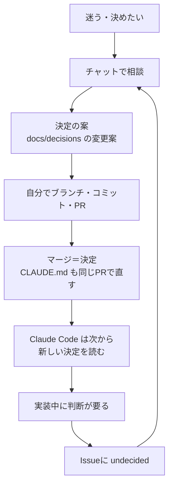

# 進め方・記録の置き場所・AIの使い分け

## 全体の流れ

週20時間（平日10時間・週末10時間）で計算した目安。12月末にローカルで一通り動かし、2月に塾で試用を始める。

| 期間 | やること | 終わりの目安 |
| --- | --- | --- |
| 10/12〜10/18 設計週 | リポジトリとIssue、ヒアリング、ユーザーストーリーと完了条件、状態遷移図・ER図・API一覧・画面一覧 | 図が `docs/` にMermaidで置かれ、MVPのIssueが全部登録されている |
| 10/19〜10/31 フェーズ0 | JavaScriptの土台。並行してリポジトリの土台（ワークスペース、Lint、Makefile、DockerのMySQL）と、空のアプリを一度Railwayに出す | TODOリストを何も見ずに書ける。`make up` で手元が立ち上がる |
| 11月 フェーズ1 | Reactで画面をダミーデータで作る | props・state・useEffect・フォームを何も見ずに書ける |
| 12月 フェーズ2 | Hono＋Drizzle＋MySQLでCRUD。同時押しのテストを本物のMySQLで書く | 依頼→申し出→選んで成立（と取り消し）がローカルで動く |
| 1月 フェーズ3 | Better Auth（メールとパスワード）→ 役割と承認待ち → LINEログイン。zodとVitest | 講師がLINEで入り、教責の承認後に使える |
| 2月 フェーズ4 | GitHub Actions、本番公開、バックアップ手順、死活監視。塾の了承をもらって試用開始 | 実際の講師が1件、代講を成立させる |

## 1つの作業の流れ（毎回同じ）

1. **Issueを1つ選ぶ**：完了条件が書いてあるものだけ着手する
2. **ブランチを切る**：名前にIssue番号を入れる（例：`feat/12-create-request`、`docs/16-claude-md-rules`）
3. **小さくコミットする**：Conventional Commits（`feat:`、`fix:`、`test:`、`docs:`、`refactor:`、`chore:`）。メッセージは「何をしたか」が分かる文にする
4. **PRを作る**：テンプレートの「何を・なぜ・確かめたこと・AIに頼んだこと」を埋め、本文に `Closes #12` と書く
5. **テストを通す**：フェーズ3までは手元の `make test`、フェーズ4からはGitHub Actions
6. **セルフレビューする**：一晩おいて差分を読み直す
7. **マージする**：Squash merge。Issueは自動で閉じる

## Issueの作り方

- 大きさ：4〜10時間で終わる大きさ。超えそうなら分ける
- 書く内容：目的、完了条件（チェックリスト）、メモ
- ラベル：種類（`story`／`task`／`bug`／`learning`）、範囲（`mvp`／`later`／`wontfix`／`undecided`）、`ai-assisted`
- マイルストーン：作るフェーズのもの（設計週、フェーズ0〜4）

## 週の回し方

- 平日（1日2時間）：着手中のIssueを1つ進める
- 週末（10時間）：まとまった実装
- 日曜の15分：KPTで振り返り、`docs/retro/日付.md` に書く。作業時間と閉じたIssueの数を記録し、翌週のIssueを選ぶ。遅れたら `mvp` から `later` へ移す

## 記録の置き場所

**同じことを2か所に書かない。** 決定の正本はリポジトリ。

| 置き場所 | 中身 | 書く人 |
| --- | --- | --- |
| `docs/decisions/` | 決定と理由（このフォルダ） | 自分（チャットが変更案を出す） |
| `CLAUDE.md` | AIが毎回読む短い要約。決定を変えるPRで一緒に直す | 自分 |
| `docs/`（その他） | ユーザーストーリー、状態遷移図、ER図、API一覧、画面一覧、振り返り | 自分 |
| GitHub Issue | 作業の単位と完了条件、未決の論点（`undecided`） | 自分 |
| PR | 実際に何を変えたか、AIに何を頼んだか | 自分 |
| 計画ドキュメント（Claude Docs） | 学習計画と、10月13日までの判断の経緯。**10月13日以降の決定は書かない** | — |

GitHub Wikiは使わない（リポジトリ本体と別の履歴になり、PRでレビューできないため）。

## AIの使い分け（チャットとClaude Code）

この節は目安。厳密に分けなくてよい（2026-10-15）。

### 基本の考え

- **チャット**（claude.ai のこのプロジェクト）は「考えて決める場所」
- **Claude Code**（WSLのターミナル、VS Code）は「リポジトリの中で手を動かす場所」
- **記録はリポジトリだけ。** どちらのAIも、会話の記憶ではなく、`CLAUDE.md` と `docs/decisions/` を読んでから答える
- GitHubへの書き込み（コミット、push、Issue、PR、マージ）は自分が行う
- 例外：PRのレビューは、頼んだときにClaude CodeがPRへコメントとして残す。1人で開発していてレビューしてくれる人がいないので、AIのレビューを記録として残す（見出しに「AI（Claude Code）によるレビュー」と書く）

### 役割の分け方

| | チャット | Claude Code | 自分 |
| --- | --- | --- | --- |
| 向いていること | 長い相談、案の比較、出典つきの調べもの、学習の説明、文書と図のレビュー | 手元のファイルを読む、差分のレビュー、エラーの原因探し、テストの実行 | 決める、書く、GitHubの操作 |
| 出すもの | 決定の案（`docs/decisions/` の変更案）、Issueの文面、レビューの指摘 | 差分への指摘、原因のヒント、頼んだときだけのコード | 実際の変更 |
| やらないこと | GitHubへの書き込み。決定を計画ドキュメントにだけ書くこと | 新しい方針を決めること | — |

### 迷ったときの振り分け

| こんなとき | 使う方 |
| --- | --- |
| どちらの方式にするか迷う、未決事項を決めたい | チャット |
| 新しい技術を調べたい（出典が要る） | チャット |
| 書いた文書・図を見てほしい（pushしてPRにしてある） | チャット（リポジトリを読める）。PRにコメントとして残したいときはClaude Code |
| 書きかけで、まだ手元にしかない | Claude Code |
| エラーが出た、テストが落ちた、コマンドの意味が分からない | Claude Code |
| コードの差分を見てほしい | Claude Code（`git diff` を読ませる） |
| Claude Codeとの作業中に「方針の判断」が要ると分かった | その場で決めない。Issueに `undecided` を付けて残し、チャットで決める |

### 受け渡し



- **チャット → Claude Code**：決定はPRで `docs/decisions/` に入れる。作業の中身はIssueの完了条件に書く。Claude Codeには、最初に「Issue #〇 をやる。CLAUDE.md と docs/decisions/README.md を読んでから」と伝える
- **Claude Code → チャット**：ブランチをpushし、PR番号を伝える。チャットはリポジトリを読んでレビューする。エラーの相談なら、エラー文をそのまま貼る（秘密の値が入っていないか確かめてから）
- チャットがリポジトリを読めるのは、セッションにリポジトリをつないでいるとき。つないでいない新しいチャットでは、PRのURLか中身を貼る

### 毎回の始め方（コピー用）

チャット：

```text
mainの CLAUDE.md と docs/decisions/ を読んでから答えてください。今日は〈何〉を決めたい（見てほしい）。
```

Claude Code：

```text
Issue #〇 をやります。CLAUDE.md と docs/decisions/README.md を読んでから始めてください。
コードは書かず、ヒントと指摘だけください。
```

### チャットで決めたことを忘れないために

- 決まったら、その場でチャットに「docs/decisions の変更案を出して」と頼む
- 1日の終わりに、決まったのにPRになっていないものがあれば、Issue（`task`）にしておく
- 設計週の終わりに、計画ドキュメントの「決定事項」タブの冒頭に「10月13日以降、決定の正本はリポジトリの docs/decisions/」と1回だけ書く。それ以降は計画ドキュメントを同期しない

## AIの使い方の記録

- `.github/pull_request_template.md` に「AIに頼んだこと」「自分で確かめたこと」の欄を置く
- AIの助けを借りたPRにはラベル `ai-assisted` を付ける
- 月末にその一覧を見返し、「AIの出力を直した例」を学習ログに1つ書く（面接で話せる）

## 決定の履歴

| 日付 | 内容 | 関連 |
| --- | --- | --- |
| 2026-10-11 | 1PRに1つの変更、Conventional Commits、AIの使い方をGitHubに残す、週1回の振り返り | — |
| 2026-10-12 | 全体の流れ（設計週〜フェーズ4）と、1つの作業の流れを決めた | — |
| 2026-10-13 | 決定の正本をリポジトリ（`docs/decisions/`）に移した。チャットとClaude Codeの使い分けを決めた | — |
| 2026-10-15 | 使い分けは目安とした。PRのレビューはClaude CodeがPRコメントとして残してよいことにした | — |
